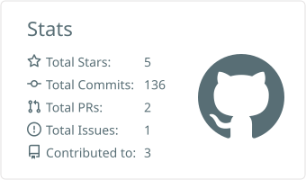
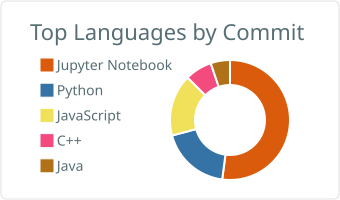
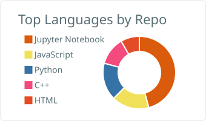
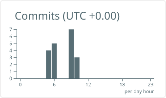

---

## 👋 About me

I'm a **Software Engineer Trainee (Data Science) at [iLink Digital](https://www.ilink-digital.com/)**, building LLM-powered applications, MCP-based tool-calling agents and Azure data infrastructure. Before that, I built Microsoft Fabric pipelines and Power BI dashboards as a Consultant Intern.

- 🤖 **Now:** fine-tuning small open-source LLMs (LoRA/QLoRA) for Power BI semantic-model automation over MCP
- 🏗️ **Day to day:** FastAPI backends, Azure SQL, embedding and retrieval pipelines, Copilot Studio agents
- 🎓 B.Tech in Electronics & Telecommunication, VIT Pune (CGPA 8.86)
- 🏆 Smart India Hackathon 2023 finalist (top 2% of 51,000 ideas)
- 💡 Patent holder and co-author of 3 peer-reviewed publications
- 📍 Pune, India · open to **Software Engineering, Generative AI and Data Engineering** roles

---

## 🚀 Featured projects

| Project | What it does | Stack | Links |
|---|---|---|---|
| **AI Software Architect** | 5-agent system with a critic-driven self-correction loop that turns plain-text requirements into specs, schemas, REST APIs and risk analysis | AutoGen, Groq, FastAPI, React, Docker | [Code](https://github.com/AnsariZayd/AI-Architect) · [Live](https://ai-architect-gamma.vercel.app) |
| **MediBook** | WhatsApp appointment platform with transaction-safe slot locking, Google Calendar sync, reminders and a React doctor portal | React, JWT, APScheduler | [Live](https://doctor-appointment-automation.vercel.app/doctor/login) |
| **iLink Tab-PBI** | Fine-tuned 3B–4B LLM + Power BI Modeling MCP server for stateful, multi-turn semantic-model tool calling | LoRA/QLoRA, MCP, Ollama, GGUF | Work project |
| **Copilot Studio RAG Agent** | Enterprise agent using GPT-4.1 mini and Claude Sonnet with Power Automate and an Azure-hosted semantic search API | Copilot Studio, Power Automate, Azure | Work project |
| **Synthetic Chest X-Ray Generation** | Diffusion-model pipeline for synthetic medical images, distributed PyTorch training | PyTorch, Streamlit, Flask | [Code](https://github.com/AnsariZayd/Synthetic-Data-Generation-Chest-X-Ray-Images) |
| **Renewable Energy Trading** | Blockchain-based renewable energy trading platform | Blockchain, JavaScript | [Code](https://github.com/AnsariZayd/RenewableEnergyTrading) |

More on my [repositories tab](https://github.com/AnsariZayd?tab=repositories).

---

## 🛠️ Tech stack

**Generative AI:** LLMs · RAG · Embeddings · AI Agents · Multi-Agent Systems · Tool Calling · MCP · Prompt Engineering · LLM Evaluation
**LLM engineering:** LoRA · QLoRA · PEFT · Hugging Face · GGUF · Ollama · AutoGen
**Data & cloud:** Microsoft Fabric · Databricks · PySpark · Azure SQL · Azure AI Services · Power BI · Medallion Architecture · SCD Type 2

  

---

## 📜 Certifications

- Microsoft Certified: **Fabric Data Engineer Associate** · Aug 2026
- Microsoft Certified: **GitHub Copilot** · May 2026
- Microsoft Certified: **Power BI Data Analyst Associate** · Oct 2025
- **Databricks** Certified Generative AI Engineer Associate · Aug 2025
- Microsoft Certified: **Fabric Analytics Engineer Associate** · Jun 2025
- **Deep Learning Specialization** (DeepLearning.AI) · Jun 2025
- More on my [LinkedIn](https://www.linkedin.com/in/ansari-zayd-ahmed-a39a59230) and portfolio

## 📄 Publications & patent

- **Patent:** *A Simulation of Microgrid System Using Microcontroller* — Application No. 2024/09335, issued Jun 2025
- **3 co-authored publications** (Elsevier, IJRES, IJSREM, 2024) on AI-driven robotic control and renewable-energy / microgrid systems

---

## 📈 GitHub activity

  
  

  <picture>
    <source media="(prefers-color-scheme: dark)" srcset="https://raw.githubusercontent.com/AnsariZayd/AnsariZayd/main/profile-summary-card-output/github_dark/3-stats.svg">
    
  </picture>
  <picture>
    <source media="(prefers-color-scheme: dark)" srcset="https://raw.githubusercontent.com/AnsariZayd/AnsariZayd/main/profile-summary-card-output/github_dark/2-most-commit-language.svg">
    
  </picture>

  <picture>
    <source media="(prefers-color-scheme: dark)" srcset="https://raw.githubusercontent.com/AnsariZayd/AnsariZayd/main/profile-summary-card-output/github_dark/1-repos-per-language.svg">
    
  </picture>
  <picture>
    <source media="(prefers-color-scheme: dark)" srcset="https://raw.githubusercontent.com/AnsariZayd/AnsariZayd/main/profile-summary-card-output/github_dark/4-productive-time.svg">
    
  </picture>

<i>Let's build something intelligent together. 🚀</i>

